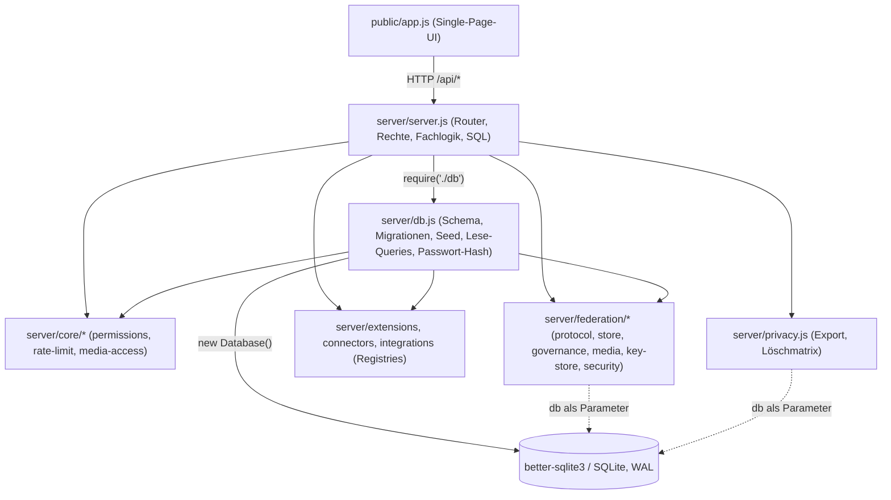

# Architektur-Bestandsaufnahme (Übergabe-Etappe 1)

Stand: 2026-11-15. Gilt für `main` @ `8214a9e`, Version 0.16.29. Issue #23. Reine Dokumentation; es wurde kein Produktcode geändert.

## 1. Grundlage und offene PRs

- Maßgeblich ist `main` (nach #36, #37, #38). PR #20 (Sicherheits-Retrofit, Node 24, `npm ci --ignore-scripts`, Rate-Limits, Key-Store) und #22 (Regeldateien) sind gemergt und in diesem Stand enthalten.
- Offen: #39 bis #42 (Pakete A bis D, gestapelt, alle mit `server/server.js` und `public/app.js`) und #43 (Playwright-Bump). Die Pakete A bis D fügen in `server/server.js` und `public/app.js` neue Routen und Logik hinzu. **Der in Abschnitt 6 vorgeschlagene Schnitt berührt keine dieser Stellen.**
- Branches ohne PR: `feature/p0.16.30-multi-reactions`, `fix/p0.16.31-chat-composer` (u. a.).

## 2. Baseline-Metriken

| Messgröße | Wert |
|---|---|
| `server/server.js` | 1.108 Zeilen, 188 KB (sehr lange Zeilen; Zeilenzahl allein unterschätzt den Umfang) |
| `server/db.js` | 1.466 Zeilen, 121 KB |
| `server/privacy.js` | 256 Zeilen, 24 KB |
| `public/app.js` / `public/style.css` | 598 Zeilen, 239 KB / 366 Zeilen, 89 KB |
| Module unter `server/{core,federation,extensions,connectors,integrations}` | 11 Dateien mit 1 bis 345 Zeilen (zusammen 1.200 Zeilen) |
| Routen in `server/server.js` | 154 (58 GET, 50 POST, 29 PUT, 9 DELETE, 8 `use`) |
| Direkte DB-Aufrufe in `server/server.js` | 375 `db.prepare`, 27 `db.transaction`, 13 `db.exec`, 4 `db.pragma` |
| Direkte DB-Aufrufe in `server/db.js` | 181 `db.prepare`, 2 `db.transaction`, 11 `PRAGMA` |
| Direkte DB-Aufrufe in weiteren Modulen | `privacy.js` 64, `federation/protocol.js` 30, `federation/store.js` 15, `federation/governance.js` 9, `federation/media.js` 7, `federation/key-store.js` 6, `extensions/registry.js` 6, `core/permissions.js` 5, `core/media-access.js` 4 |
| Tabellen (`CREATE TABLE IF NOT EXISTS` in `db.js`) | 71, dazu die Föderationstabellen in `federation/store.js` |
| Indizes | 21 in `db.js` |
| Funktionen | `server.js` 62, `db.js` 74 |
| Tests | 66 Preflight-Skripte in `scripts/`, 11 Integrationsdateien, 8 Sicherheitstests in `tests/security`, 72 Playwright-Fälle in 16 Spec-Dateien (Gold-Specs: desktop 20, mobile 14, dazu messaging, registration, core-journey, account-transition) |

**Direkte DB-Zugriffe außerhalb von `server/db.js`: rund 540** (davon 419 in `server.js`). Ein Repository- oder Adapter-Layer existiert nicht.

## 3. Abhängigkeitskarte

Befunde mit Belegen:

1. **`server/db.js` ist kein Adapter, sondern ein Sammelmodul.** Es öffnet die Datenbank (`new Database(dbPath)`, Zeile 13, Pragmas 15 bis 18), legt das komplette Schema an, führt Migrationen aus, enthält die Demodaten (`seed`, Zeile 876), die Berechtigungsfunktionen für Sichtbarkeit (`canViewScope`, `canViewCommunityRow`), Lese-Queries für Detailansichten (`communityDetail`, `eventDetail`, `projectDetail`, `participationDetail`, `userProfile`, `listPeople`) und Passwort-Hash/-Prüfung (`hashPassword`, `verifyPassword`). Exportiert werden 40 Namen, darunter das rohe `db`-Objekt (Zeile 1465).
2. **`server.js` greift direkt auf `db` zu.** Es importiert `./db` und nutzt die exportierte Verbindung in Routen-Handlern mit eigenem SQL. Router, Autorisierung, Fachablauf und SQL liegen in denselben Funktionen.
3. **Die Modulschicht ist von `db.js` abhängig und umgekehrt.** `db.js` importiert `core/permissions`, `extensions/registry`, `federation/{governance,media,protocol,store}`; `server.js` importiert dieselben Module. Es gibt also einen Zyklus der Verantwortung (`db.js` kennt Föderation und Erweiterungen), auch wenn kein `require`-Zyklus zur Laufzeit auftritt.
4. **Positiv:** `federation/*`, `privacy.js` und die Kernmodule bekommen `db` als Parameter (`installFederationSchema(db)`, `upsertLocalEntity(db, …)`). Das ist bereits eine Einspritzstelle, an der später ein Repository ansetzen kann. Es ist aber **kein** Adapter-Vertrag: Die Module schreiben SQLite-SQL direkt.
5. **Keine Trennung Router, Anwendungsdienst, Domain.** Es gibt keine Router-Dateien und keine Service-Schicht. `server/core/architecture.js` beschreibt die Zielschichten, wird aber nur als Katalog ausgegeben (`/api/architecture`) und stellt keine Trennung her.
6. **Routenverteilung** (Anzahl in `server.js`): `/api/communities` 24, `/api/participation` 16, `/ap` 13, `/api/events` 9, `/api/messages` 8, `/api/federation` 7, `/api/posts` 6, übrige Gruppen 1 bis 4.

## 4. SQLite-spezifisches und Migrationspunkte

- **Initialisierung:** `server/db.js` Zeilen 13 bis 18 (Pragmas `journal_mode=WAL`, `foreign_keys=ON`, `busy_timeout=5000`, `synchronous=NORMAL`). Das Datenbankverzeichnis wird über `BUP_DB_PATH` oder `data/bottomupparti.db` gewählt.
- **Schema:** ein großer `db.exec`-Block mit `CREATE TABLE IF NOT EXISTS` (71 Tabellen). Die Föderationstabellen entstehen getrennt in `federation/store.js` (`installFederationSchema`).
- **Migrationsmechanismus:** keine Versionsnummer (`PRAGMA user_version` oder Migrationstabelle) und keine Migrationsdateien. Spalten werden idempotent mit `ensureColumn(table, column, definition)` ergänzt (Zeile 600, nutzt `PRAGMA table_info`), insgesamt 6 `ALTER TABLE`. Größere Umbauten laufen als Tabellen-Neuaufbau mit `PRAGMA foreign_keys=OFF/ON` (Zeilen 690, 741, 774, 795, 809). Eine Rollback- oder Rückfallstrategie ist im Code nicht vorhanden.
- **Seed/Bootstrap:** `seed()` (Zeile 876) und `bootstrap`; Demodaten beim leeren Datenbestand. `NODE_ENV=production` blockiert vorhandene Demo-Accounts (siehe `README-WINDOWS.md`).
- **SQLite-spezifische Syntax** (Treffer in `server.js` / `db.js` / übrigen Modulen): `INSERT OR IGNORE` 28 / 19 / 3, `INSERT OR REPLACE` 2 / 0 / 0, `datetime(...)` 26 / 17 / 8, `COLLATE NOCASE` 0 / 0 / 2, `PRAGMA` 0 / 11 / 1. `CURRENT_TIMESTAMP` (30 / 63 / 54) ist teilweise portabel. Das ist der Hauptaufwand für einen zweiten Adapter, zusammen mit `better-sqlite3`s synchroner API (`db.transaction(fn)()`), die kein asynchrones PostgreSQL-Gegenstück hat.
- **Keine Behauptung einer Adapter-Trennung:** Weder ein Repository-Vertrag noch ein zweiter Adapter existieren. Alle Zeilenangaben oben beziehen sich auf `main` @ `8214a9e`.

## 5. Sicherheits- und Rechteprüfungen (Orientierung für spätere Schnitte)

- Rechte: `server/core/permissions.js` (`hasPermission`, 22 Zeilen, aufgerufen mit Space-Typ, Space-ID und Aktion), dazu `mustBeMember`, `canViewScope` und Rollenzuweisungen in `role_assignments` / `permission_overrides`.
- Alle schreibenden Routen prüfen im Handler: `requireUser` → Mitgliedschaft → `hasPermission`. Die Prüfung ist **in jede Route eingebettet**, nicht zentral. Bei einem Umbau muss sie unverändert und vor dem Datenzugriff bleiben.
- Querschnitt: Rate-Limits (`core/rate-limit.js`, getrennte Lese-/Schreibbudgets), CSRF-/Sicherheits-Token, Sitzungen (nur Hash gespeichert), `no-store`-Header, Medienzugriff (`core/media-access.js`), Export/Löschung (`privacy.js` mit Löschmatrix `PRIVACY-DATA-LIFECYCLE-P0.5.md`).
- `privacy.js` hat eine eigene Tabellen-Matrix (`ANONYMIZE_TOMBSTONE`, `DELETE`, …). **Jede neue oder verschobene Tabelle muss dort eingetragen bleiben**; ein Repository darf diese Matrix nicht umgehen.

## 6. Vorschlag für den ersten vertikalen Schnitt (Etappe 2): Legacy-Umfragen

**Funktion:** einfache Umfragen in Communities (`polls`, `poll_options`, `poll_votes`).

**Warum geeignet:**
- Kleinster in sich geschlossener Datenbereich: 3 Tabellen, 2 Schreibrouten, 1 Leseabfrage.
- Wenige SQLite-Besonderheiten: eine `datetime(...)`-Sortierung (`db.js:1411`), sonst Standard-SQL.
- Berührt keine der Dateibereiche von #39 bis #42 (Beitrittsanfragen, Benachrichtigungen, Netzwerk), also kein Konfliktrisiko mit offenen PRs.
- Keine Föderation, keine Medien, keine Chat-Daten.

**Beteiligte Codepfade (alle belegt):**
- `POST /api/communities/:id/polls` (`server.js:892`): Mitgliedschaft und `content.create`, Eingabe-Normalisierung, Transaktion mit `INSERT` in `polls` und `poll_options`.
- `POST /api/polls/:pollId/vote` (`server.js:898`): Option-Nachschlagen, `mustBeMember`, `participation.interact`, Transaktion (alte Stimmen löschen, neue schreiben).
- Leseseite: `pollsForCommunity` (`db.js:1411`), aufgerufen von `communityDetail` (`db.js:1459`).
- Datenschutz: `privacy.js` Zeilen 58, 59 (Export) und 159 (Löschung der Stimmen), Matrix-Eintrag in Zeile 13.
- Seed: `db.js` Zeilen 981 bis 983.

**Wichtiger Vorbehalt (Auth-Grenze):** Beide Schreibrouten enthalten Rechteprüfungen. Die Roadmap rät davon ab, Auth-/Privacy-Grenzen als erste Übungsstrecke zu nehmen. Der Schnitt ist deshalb bewusst so gezogen, dass **die Rechteprüfung unverändert im Router-/Policy-Teil bleibt** und nur der Datenzugriff (die drei Tabellen) hinter einen `PollRepository`-Vertrag wandert. Wer mit der Einschränkung nicht leben will, kann als Alternative die Aufgaben (`tasks`) oder die Themenliste nehmen; beide haben aber mehr Verknüpfungen bzw. keine eigene Route und sind weniger abgeschlossen.

**Zielzuschnitt:** `server/repositories/poll-repository.js` (Vertrag: `createPoll`, `findOptionWithPoll`, `replaceVote`, `listForCommunity`) mit SQLite-Implementierung in `server/repositories/sqlite/poll-repository.js`; Router ruft einen kleinen `poll-service`, der die bestehende Reihenfolge Mitgliedschaft → Recht → Daten beibehält. `pollsForCommunity` ruft das Repository auf.

**Unverändertes Verhalten (Abnahme):** gleiche Statuscodes (400/403/404/201/200), gleiche Fehlertexte, eine Stimme pro Person und Umfrage, Stimmenzählung und `voted`-Flag, Löschung der Stimmen bei Kontolöschung, Export enthält Umfragen und Stimmen unverändert, `propagation_scope` bleibt erhalten.

**Tests vor dem Umbau (Charakterisierung):**
- Vorhanden: `tests/integration/security-permissions.integration.js` (Zeilen 110 bis 129: Fixture, „Demotion also blocks legacy votes“).
- Neu (vor dem Umbau, auf unverändertem Code grün): Integrationstest für Erstellen (400 bei fehlender Frage oder < 2 Optionen, 403 ohne Recht), Abstimmen (404 bei fremder Option, 403 ohne Mitgliedschaft, Umentscheiden ersetzt die Stimme), Detailansicht mit Zählung. Gegenprobe: Der Test schlägt an, wenn die Stimmenersetzung entfernt wird.
- Danach alle Gates: `preflight`, `qa:security`, `qa:gold`; Browser-Gold Desktop und Mobile.

**Risiken:** Der Preflight `module-boundary-preflight.js` und weitere Zeichenkettenprüfungen können auf Dateinamen oder Quelltext reagieren (Regel „keine Tests über Tests“). Neue Dateien müssen in die Löschmatrix-Prüfung (`privacy-schema-policy-preflight`) passen.

## 7. Priorisierter Backlog (Vorschlag, Freigabe offen)

1. **Etappe 2:** Legacy-Umfragen als Schnitt (Abschnitt 6).
2. `db.js` aufteilen, ohne Verhalten zu ändern: Schema/Migrationen, Seed, Lese-Queries (Detailansichten), Passwort-Hash in getrennte Dateien. Das Verbindungsobjekt wird danach nur von der Datenschicht gehalten.
3. Versionierte Migrationen einführen (Tabelle `schema_migrations`), `ensureColumn` und Tabellen-Neuaufbau als nummerierte Schritte; Voraussetzung für Etappe 5 und für jeden zweiten Adapter.
4. Router aus `server.js` nach Domänen herauslösen (zuerst kleine Gruppen wie `/api/blocks`, `/api/preferences`, `/api/health`), erst nach Abschluss der gestapelten PRs #39 bis #42, um Konflikte zu vermeiden.
5. Rechteprüfung als wiederverwendbare Policy-Funktionen statt eingebettet in jeder Route (Voraussetzung dafür, dass Services ohne Router testbar werden).
6. `privacy.js` auf Repository-Aufrufe umstellen; Löschmatrix und Repositories zusammen prüfen (Preflight, der jede Tabelle einer Policy zuordnet, existiert bereits).
7. Etappe 3 (Zweitadapter, PostgreSQL-Testprototyp) erst nach Etappe 2 und Migrationen; SQLite-Syntax (Abschnitt 4) und die synchrone API sind der Hauptaufwand.

## 8. Offene Risiken

- **Monolith mit eingebetteten Rechten:** Ein Umbau kann Rechteprüfungen versehentlich verschieben. Mitigation: pro Schnitt negative Rechte-Tests vorher und nachher, Reihenfolge Mitgliedschaft → Recht → Daten unverändert.
- **Kein Migrationssystem:** Schemaänderungen laufen implizit beim Start. Eine Fehlmigration hat keinen Rückfallweg.
- **Synchrone Datenbank-API:** Transaktionen nutzen `db.transaction(fn)()`; ein asynchroner Zweitadapter braucht einen anderen Vertrag.
- **Zeichenkettenprüfungen im Preflight** (rund 1.000, Register 2026-10-27) können verhaltensgleiche Umbauten blockieren; betroffene Prüfungen werden im selben PR auf Verhalten umgestellt.
- **Gestapelte PRs #39 bis #42** ändern `server.js` stark; Router-Extraktionen erst danach.
- **Branch-Schutz für `main` fehlt** (K5): Der Umbau braucht menschliche Prüfung jedes PR, technisch nicht erzwungen.

## 9. Ausgeführte und nicht ausgeführte Tests

Umgebung: Windows 10, Node v24.20.0 (die `engines`-Vorgabe verlangt ≥ 24.22.1; lokal verwundbarer Patchstand, K4), Worktree auf `main` @ `8214a9e`, `node_modules` aus dem Hauptverzeichnis verknüpft.

| Prüfung | Ergebnis |
|---|---|
| `npm run preflight` | Exit 0; letzte Prüfgruppe „Security hardening bundle“ 31/31 |
| `npm run qa:security` | Exit 0; u. a. Post publication 57/57, Federation exposure 26/26, Session lifecycle 39/39, `qa:retrofit` 8/8 |
| `npm run qa:gold`, `qa:smoke`, `qa:layout`, `qa:accessibility` | **nicht ausgeführt** (Browser-Läufe; nach Stand der CI für `main` in GitHub grün, hier nicht neu bestätigt) |

Die Zahlen in Abschnitt 2 wurden mit `wc`, `grep` und Quelltextlektüre ermittelt und zählen Vorkommen im Text; sie sind Größenordnungen, keine Metrik eines Analysewerkzeugs.
